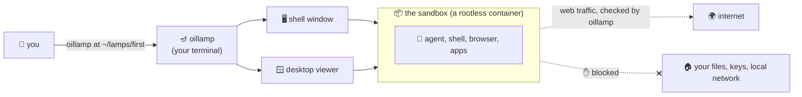

# 🪔 OiLLaMp

**Give your AI coding agent its own Linux computer, with a desktop. It runs on your machine, but
it cannot reach your machine.**

AI coding agents do their best work when they can act like a programmer: install packages, run the
program, open a browser, look at the screen and click on things. Doing that on your own computer
puts your files, your SSH keys and your other projects within the agent's reach. A virtual machine
keeps them out of reach, but it is slow to set up and heavy to run.

oillamp sits in between. You run one command, and a few seconds later two windows open:

- 🖥️ a **terminal** logged into a sandboxed Linux system, and
- 🪟 a **viewer** showing that system's graphical desktop.

The agent working in there can install things, start Firefox, run GUI applications (Java Swing
included), take screenshots of its own screen and click on its own windows. It can reach the
internet. It **cannot** see your home directory, your keys, your other projects or your local
network. When you are done, one command removes the whole thing.



---

## 🚀 Quickstart

### What you need

- 🐧 **Linux** on a 64-bit Intel or AMD machine. Developed and tested on **Ubuntu 24.04**; other
  distributions should work but have not been tried.
- 🪟 **A graphical desktop session** (Wayland or X11), because oillamp opens windows.
- That's it. You do **not** need Java, Docker or root. If `podman` (the program that runs the
  sandbox) is missing, oillamp installs it for you and asks for your password once.

### 1. Get the program

oillamp is a single file of about 40 MB, with its own Java runtime inside. Build it once (this step
does need a JDK 25):

```sh
./gradlew singleFile
cp build/dist/oillamp ~/bin/      # or anywhere on your PATH
```

You can copy that file to any other Linux machine and run it there. Nothing gets installed.

### 2. Check your machine

```sh
oillamp doctor
```

This changes nothing. It lists **everything** that would stop a sandbox from starting (all at
once) and gives the exact command that fixes each one.

```
🪔 oillamp 0.2.0
[host]    ✓ Ubuntu 24.04.5 LTS, Wayland (ubuntu:GNOME)
[host]    ✓ podman 4.9.3, rootless, crun
[host]    ✓ this machine can run oillamp sandboxes
```

### 3. Start a sandbox 🔥

```sh
export EDENAI_API_KEY=...          # optional: the model key; oillamp keeps it, the sandbox never sees it
oillamp at ~/lamps/first
```

`~/lamps/first` is a directory you pick. oillamp creates it and keeps **everything** about this
sandbox inside it. oillamp calls such a directory a **lamp**.

⏳ The first start builds the sandbox image (about 3.5 GB: Debian, a JDK, Node.js, Python,
Firefox, a desktop and two agent harnesses) and takes several minutes. After that, starting takes
a few seconds, because the image is reused: by later sessions, and by any lamp with the same
settings. Its agent tools do not update by themselves; see
[Updating the agent tools](#-updating-the-agent-tools).

Then the two windows open. The terminal you typed in stays where it is and shows the sandbox's
health until the session ends:

```
🪔 oillamp 0.2.0 — /home/you/lamps/first
[host]    ✓ Ubuntu 24.04.5 LTS, Wayland (ubuntu:GNOME)
[host]    ✓ podman 4.9.3, rootless, crun
[lamp]    ✓ config valid — network: default allow, 2 rules, no forwards
[lamp]    ✓ desktop 1920x1080, renderer gles2 (hardware)
[image]   ✓ sandbox image ready — localhost/oillamp/sandbox:0a6f7ffa4c89ca64
[session] ✓ sandbox running — container oillamp-v4elchzj
[session] ✓ desktop and shell both answering
[session] ✓ opened the desktop viewer
[session] ✓ opened your shell, in a new terminal window
```

### 4. Bring in a project and start the agent 🤖

The sandbox cannot see your files, and that is the point. In the sandbox shell, clone what you
want to work on and start a harness:

```sh
cd ~/workspace
git clone https://github.com/you/your-project.git
cd your-project
pi                     # or: opencode
```

The agent finds `~/AGENTS.md`, which explains the sandbox to it: what lasts between sessions, how
to drive the desktop, and why a request might be refused. It drives the desktop with a small
helper:

```sh
lamp screenshot                    # capture the screen, print the file's path
lamp click 960 540                 # click where a screenshot shows something
lamp type "hello"                  # type text
lamp key ctrl+shift+t              # press a key combination
lamp wait-stable                   # wait until the screen stops changing
```

### 5. Stop, and come back later 💤

Press **Ctrl-C** in the terminal you started from, close that terminal, or run
`oillamp stop ~/lamps/first` from anywhere.

Closing the shell window or the viewer does **not** end the session. Open new ones with
`oillamp shell ~/lamps/first` and `oillamp view ~/lamps/first` whenever you like.

The files stay on disk. `oillamp at ~/lamps/first` brings everything back, including what the
agent put in its home directory.

### 6. Go back in time ⏪

Save the agent's home, the lamp's `oillamp.toml` and its jobs whenever you like, even while the session runs.
oillamp can also save by itself as each session starts and ends, if anything changed: switch that on
with `oillamp history ~/lamps/first autosave startup on shutdown on`, or under `[autosave]` in `oillamp.toml`.

```sh
oillamp history ~/lamps/first save -m "before the big refactor"
oillamp history ~/lamps/first
```

```
SNAPSHOT  SAVED (UTC)          KIND                          MESSAGE
5e6f7a8b  2026-09-29 18:40:12  running save                  before the big refactor
3f2a9c1d  2026-09-29 18:14:03  startup save                  session 20260929-181400
```

If the agent wrecks something, stop the session and go back:

```sh
oillamp stop ~/lamps/first
oillamp history ~/lamps/first restore 3f2a9c1d
```

Everything comes back as it was, including projects the agent cloned (with their own git history),
file permissions and links, and the jobs on the schedule. Whatever the agent made after the
snapshot is removed, jobs included. Before it changes anything, `restore` saves the lamp once more
and prints how to undo the restore. The agent cannot see or change these snapshots.

### 7. Let the agent work on a schedule ⏰

While a session runs, oillamp can wake the agent at set times with a task. It is off by default,
because every run costs model tokens. Turn it on for one session:

```sh
oillamp at ~/lamps/first --enable-scheduling
```

or for every session, in the lamp's `oillamp.toml`:

```toml
[schedule]
enabled = true
```

Then add jobs:

```sh
oillamp schedule ~/lamps/first add --cron "0 9 * * 1-5" "Check the nightly build and fix what broke"
oillamp schedule ~/lamps/first add --at "in 2h" "Write up what you found today"
oillamp schedule ~/lamps/first                       # list the jobs, and when each runs next
oillamp ask ~/lamps/first "What are you working on?" # wake it now, and print its answer
```

The agent is pi, which the session starts and keeps. It works on one thing at a time; anything that
comes while it is busy waits its turn. Each run starts a fresh pi conversation, so the agent
keeps notes for itself in `~/workspace/NOTES.md`, and oillamp puts those notes, what the last few
runs changed, and the last run's final message into the prompt.

pi answers with the default model in its settings in the sandbox, and in an old conversation with
the model that conversation was on. To have every run answered by one model, old conversations
included, give it to the session, as the service names it:

```sh
oillamp at ~/lamps/first --model azure/gpt-6.1-sol
```

The session also writes it as pi's default, in `~/.pi/agent/settings.json` in the sandbox, so a
new conversation starts on it. The earlier answers keep the model that gave them. A model the
service does not offer fails the run, and says so. A running session takes another model with
`oillamp model ~/lamps/first <id>`, from its next run on; the sandbox keeps running.

To tell the agent something for the whole session, in addition to pi's own instructions, put it
in a variable and name the variable:

```sh
INSTRUCTIONS="$(cat ~/notes/about-the-project.md)" oillamp at ~/lamps/first --instructions-env INSTRUCTIONS
```

The session writes the text to `~/.pi/agent/APPEND_SYSTEM.md` in the sandbox, which pi adds to its
system prompt in every conversation. A session started without it leaves that file as it is.

Every run is saved just before and just after, so `oillamp history <dir>` reads as a log of what the
agent did, and `oillamp history <dir> restore` undoes any run.
`oillamp history <dir> autosave before-run off after-run off` switches that off; the agent's next
prompt then says nothing about its earlier runs:

```
SNAPSHOT  SAVED (UTC)          KIND                          MESSAGE
0c1c81ec  2026-09-29 09:00:27  run                           run-4 (job job-1) finished
04b875f4  2026-09-29 09:00:01  save before a run             before run-4
```

The agent can add jobs for itself with its `schedule_add` tool. oillamp decides whether to accept
them: the agent may have only a few jobs, which run at most every 15 minutes and expire after 14
days, and it cannot touch yours. Jobs only run while the session runs: nothing wakes a lamp that
is not lit. A run the session finds more than 30 minutes late (`max_delay_minutes` under
`[schedule]`, 0 for no limit) is missed rather than made late: an hourly job on a lamp started after
a weekend runs at its next full hour. `oillamp schedule <dir> pause` stops all runs without stopping
the session; after `resume`, each repeating job runs at its next time from then.

### 8. Delete it when you are done 🧹

```sh
oillamp remove ~/lamps/first           # shows what would be deleted, deletes nothing
oillamp remove ~/lamps/first --yes     # deletes it
```

Use this instead of `rm -rf`. Some files in a lamp belong to the sandbox's own internal user, and
your account is not allowed to delete them directly. `oillamp remove` knows how.

---

## 🧰 All the commands

```sh
oillamp at <dir>                 # start (or resume) a sandbox in <dir>
oillamp update <dir>             # newer opencode and pi, and a fresh model list
oillamp update <dir> --system    # the whole image again, with Debian's updates
oillamp at <dir> --dry-run       # print every step it would take, and do nothing
oillamp at <dir> --model <id>    # answer every run with this model, old conversations too
oillamp at <dir> --instructions-env <name>  # tell the agent what this variable holds
oillamp doctor [<dir>]           # check this machine (and a lamp's config), change nothing
oillamp view <dir>               # open another desktop viewer
oillamp shell <dir>              # open another shell, in this terminal
oillamp status <dir>             # what a running session is doing
oillamp stop <dir>               # end a session from anywhere
oillamp list                     # every oillamp sandbox running on this machine
oillamp remove <dir>... [--yes]  # delete one or more lamps
oillamp history <dir>            # list the lamp's snapshots
oillamp history <dir> save [-m <text>]    # take a snapshot of the lamp, even while it runs
oillamp history <dir> restore <snapshot>  # go back to a snapshot (stop the session first)
oillamp history <dir> autosave [<moment> on|off]...  # when oillamp saves by itself
oillamp schedule <dir> [add ...] # list or change the jobs that wake the agent
oillamp ask <dir> "<prompt>"     # wake the agent in a running session, print its answer
oillamp cancel <dir> [<run>]     # stop the agent's run
oillamp model <dir> <id>         # answer with this model from the next run on, without restarting
oillamp conversations <dir> [<id>] # list the agent's conversations, or show one
oillamp recordings <dir>         # list screen recordings (if recording is on)
oillamp config <dir> check       # validate the lamp's oillamp.toml
oillamp guide                    # a first session, step by step, in your terminal
oillamp about                    # why oillamp exists and what it is built from
```

Add `--verbose` to any command to see every step as it happens. For tab completion:

```sh
eval "$(oillamp completion bash)"                        # this shell only
echo 'eval "$(oillamp completion bash)"' >> ~/.bashrc    # every future shell
```

---

## 🔄 Updating the agent tools

The image comes with opencode, pi, and opencode's list of Eden AI models. All three are
downloaded once, when the image is built. After that the image is reused, by later sessions and
by every lamp with the same settings, even a new one. Starting a lamp never checks for newer
releases.

To get newer tools, run this **on the host**:

```sh
oillamp stop ~/lamps/first        # update refuses a lamp that is running
oillamp update ~/lamps/first      # add --dry-run to see the plan first
oillamp at ~/lamps/first
```

`update` builds a new image for this lamp only. It installs the latest opencode and pi (or the
versions you pinned, see below) and downloads opencode's model list again. The next session
starts from that image. Other lamps keep the image they have. On the second and later updates,
the image of the previous update is removed, as no other lamp uses it.

- **The agent's home is not touched.** The workspace, settings, extensions and everything else
  in `/home/agent` stay as they are.
- **A failed update changes nothing.** If an install or the model list download fails, the lamp
  keeps its previous image.
- **Only the agent tools are refreshed.** Debian packages, the JDK and Node.js come from the
  earlier, cached part of the image. For those, see the next section.
- **`restore` does not undo an update.** Snapshots hold the home, `oillamp.toml` and the jobs, not the
  image. After a restore, the lamp still runs the updated tools.

To pin a version, edit the lamp's `oillamp.toml`. Each value is `latest` or an exact release:

```toml
[agent_tools]
versions = { opencode = "latest", pi = "1.2.0" }
```

### Updating Debian and everything else in the image

Debian, Firefox, openssh, the graphics libraries (Mesa), the JDK and Node.js are also fixed on
the day the image was built. A plain `update` keeps them, so it is quick. To update them as well:

```sh
oillamp update ~/lamps/first --system
```

This builds the whole image again: podman fetches the newest `debian:trixie` and runs every step
of the build, so `apt-get` installs each package's latest updates. It takes as long as a first
build. The same rules apply as for a plain update: the lamp must be stopped, the home is not
touched, and a failed build changes nothing.

When a session starts from an image built more than 30 days ago, oillamp warns and names this
command. Run it every few weeks, and after a security fix you care about, such as one for Firefox
or openssh.

### Old images fill the disk

Each image takes about 3.5 GB. A new one is made by every update, and by every start after a
change to the image's settings or to oillamp itself. oillamp removes only the image an update
replaces. The others stay, and every build that makes a new image warns about them. Removing
them is up to you, because only you know which lamps you still need:

```sh
podman system df                              # how much space images take
podman images localhost/oillamp/sandbox       # oillamp's images, newest first
podman rmi <image>                            # remove one; refused while a container uses it
podman image prune                            # remove untagged layers from earlier builds
```

### A copy in the agent's home wins

Inside the sandbox, `~/.local/bin` comes before `/usr/bin` on `PATH`. If you or the agent
installed opencode or pi into the home, that copy runs, and `update` does not change it. `update`
warns when it finds one. To see which copy runs, **inside the sandbox**:

```sh
command -v opencode pi           # /usr/bin/... is the image's copy
/usr/bin/pi --version            # the image's copy, whatever PATH says
```

To go back to the image's copy, remove the one in the home:

```sh
npm uninstall -g --prefix "$HOME/.local" @earendil-works/pi-coding-agent   # or opencode-ai
hash -r                          # make bash forget the old location
```

### Updating from inside the sandbox instead

You can also install a newer version into the home, from inside the sandbox, without stopping the
lamp:

```sh
npm install -g --prefix "$HOME/.local" @earendil-works/pi-coding-agent@latest   # or opencode-ai@latest
hash -r
```

This is quicker, but it has two drawbacks:

- ⚠️ **The agent can change that copy.** The agent runs as `agent`, the user that owns the home.
  The copy in the image is read-only.
- **opencode's model list stays the same.** The list is part of the image
  (`/usr/local/share/oillamp/opencode/opencode.json`), so only `update` refreshes it.

pi's extensions live in the home, and `pi update --extensions` updates them from inside the
sandbox.

---

## ⚙️ Configuring a lamp

Every lamp has an `oillamp.toml`, created with every setting present and explained in comments.
The agent cannot see or change this file. A few highlights:

```toml
[display]
width  = 1920
height = 1080
gpu    = "auto"              # use your graphics card if possible, fall back if not

[recording]
enabled = false              # true records the whole desktop session to a video file

[image]
extra_apt_packages = []      # system packages to bake into the sandbox image

[schedule]
enabled = false              # true lets jobs wake the agent while a session runs

[network]
default = "allow"            # what happens when no rule matches

[[network.rules]]            # rules are checked top to bottom, first match wins
label  = "company artifact mirror"
action = "allow"
hosts  = ["nexus.corp.example.com"]
```

The shipped rules block your local network and this machine's loopback, and send Eden AI traffic
only to its EU endpoint. When the agent hits a blocked address, it gets a clear refusal naming the
rule, and you see the refusal in your terminal.

Edit, check with `oillamp config <dir> check`, and restart the session to apply. An optional
`~/.config/oillamp/config.toml` sets defaults for all your lamps.

---

## 🛡️ What it protects, and what it doesn't

oillamp is built to keep an agent away from **your computer**. It is not built to stop an agent
from talking to the internet.

✅ **Protected:**
- Your home directory, SSH keys and other projects: the sandbox cannot see them.
- Your local network and the services on your machine: the sandbox has no network of its own,
  and every connection goes through a policy check in oillamp.
- The desktop, the screen recording and the network connections: they run as a separate user
  the agent cannot touch.
- Your system: nothing in the sandbox runs as root on your machine.

⚠️ **Not protected:**
- **The agent runs as you**, inside the container. What keeps it away from your files is what
  the container can see, not file permissions. A kernel flaw, or a wrongly attached directory,
  would give it your rights (never root's).
- **It is a container, not a virtual machine.** Your kernel is shared with the sandbox.
- **The internet is open by default.** Data the agent can read, it can send. That is why the model
  key is not in the sandbox: oillamp adds it to model requests on their way out.
- **Your machine's own public addresses are not blocked.** If a service on your machine listens
  on every address (`0.0.0.0`), add a deny rule for your addresses, or bind it to `127.0.0.1`.
- **Disk space has no limit.** An agent that downloads without end can fill your disk. The
  history keeps every version of every file that was ever saved, and nothing removes old
  snapshots yet.

---

## 📚 Learn more

| I want to… | Read |
|---|---|
| understand the tools oillamp is built from (containers, podman, uid maps, Wayland, VNC, Java…) | [docs/TECH-STACK.md](docs/TECH-STACK.md) |
| understand how oillamp works inside: startup order, moving parts, where state lives | [docs/ARCHITECTURE.md](docs/ARCHITECTURE.md) |
| know why it was built this way | [docs/DECISIONS.md](docs/DECISIONS.md) |
| know what is verified, and what is still missing | [docs/STATUS.md](docs/STATUS.md) |
| build, test and change oillamp | [CONTRIBUTING.md](CONTRIBUTING.md) |
| let the agent reach the host, judged by a model against your own requirements (planned) | [docs/HOST-ACCESS.md](docs/HOST-ACCESS.md) |

## ⚖️ License

oillamp and Genies are MIT licensed: see [LICENSE](LICENSE).

---

*Version 0.2.0. Everything planned for the first version works on Ubuntu 24.04, apart from a
proxy setting for Firefox and configuring the agent harnesses for a company LLM. See
[docs/STATUS.md](docs/STATUS.md) for details.*
