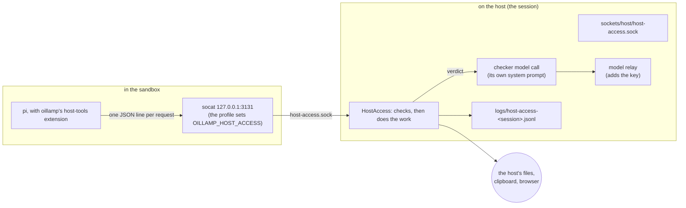

# Reaching the host: supervised host access

This document specifies a way for the agent inside a lamp to ask for things on the host machine,
with every request first judged by a separate model call against requirements the user wrote. It
was written before the code, so that the shape was agreed before anything was built. Most of it is
built now: where it sits in the code is in [ARCHITECTURE.md](ARCHITECTURE.md#supervised-host-access),
and what is still missing is in [STATUS.md](STATUS.md#host-access-still-missing). When the rest is
built, move the decisions into [DECISIONS.md](DECISIONS.md) and replace this document with a link.

---

## The problem

A lamp is useful because the agent cannot reach the host. That is also what stops it from being an
assistant: it cannot read the document the user is looking at, put a file where the user will find
it, open a page in the user's browser, or read the clipboard.

The obvious fix is a permission system: the agent asks for a path, the user maintains a list of
allowed paths, and so on. The people who maintain it are IT specialists. Everyone else either
allows everything on the first day or turns the feature off.

oillamp takes a different route. The agent may ask for anything the feature offers, at any time.
A second model call, with its own system prompt and **without the agent's conversation**, decides
whether each request is allowed. The requirements it judges against are a piece of text the user
wrote. The metaphor is a manager who cannot see the agent's screen but can see what it is about to
do, and knows what the user asked for.

This is a trade, not a guarantee. It is described under [What it does not
guarantee](#what-it-does-not-guarantee).

---

## Vocabulary

| Word | Meaning |
|---|---|
| **host access** | The feature: host tools the agent can call, each request judged before it runs. |
| **requirements** | The user's text that every request is judged against. One `String`, and nothing else. |
| **checker** | The model call that reads a request and answers with a verdict. Separate from the agent's conversation. |
| **request** | One call of one host tool: the tool's name, its arguments, and the run it came from. |
| **tier** | A class of tools with the same ceiling: passive, additive, executing. The checker may tighten a tier's ceiling, never widen it. |
| **activity** | The recent tool calls, the reasoning trace, and the user's instruction of the run the request came from, kept on the host. |
| **verdict** | The checker's answer: allow or deny, a risk tier, a reason, and anything it wants the user to know. |

---

## The shape

The agent never gets a pipe to the host. It gets a small set of **typed tools**; each one's
implementation is a request over a Unix socket; the host does the judging **and** the work.



Why it is shaped this way, and what was considered instead, is under [Decisions](#decisions). The
short version: the part inside the sandbox can be tampered with freely, because tampering gains
nothing. All judgement and all effect happen on the host.

---

## Configuration

Off by default, and entirely optional. It is on only when the lamp's `oillamp.toml` turns it on,
or an application starts the session with its own requirements in its environment.

```toml
[host_access]
enabled = true

# What the agent may do on this machine, in your own words. This text goes to the checker with
# every request, and nowhere else. The agent never sees it. Write what must not happen; that is
# what a checker can act on.
requirements = """
You may read anything under ~/Documents and ~/Notes.
Never write outside ~/Downloads/oillamp/.
Never read ~/.ssh, ~/.gnupg, ~/.config, or any file whose name contains "password" or "secret".
Do not open web pages unless I asked for one in this conversation.
"""
```

| Key | Default | Meaning |
|---|---|---|
| `host_access.enabled` | `false` | Turn the feature on. Off means no socket, no extension, no tools. |
| `host_access.requirements` | `""` | The user's text. Cannot be empty while `enabled` is true. Multi-line TOML strings work. |
| `host_access.checker_model` | `""` | The model that judges, as the service names it. Empty means the model the agent answers with, followed when it changes; a session with host access on and neither does not start (`OIL-HOSTACCESS-015`). See [The checker uses the agent's model](#the-checker-uses-the-agents-model). |
| `host_access.roots` | `[]` | Absolute host paths the `host_*` file tools may mention at all. Empty means the whole home directory, and nothing else. |
| `host_access.max_read_bytes` | `65536` | How much of one file is handed to the agent. More is cut, and the agent is told. |
| `host_access.executables` | `[]` | Programs the agent may ask to run on the host. Empty means none, and the executing tier is closed. |
| `host_access.allow_additive` | `true` | Allow the additive tier (writing and copying files out, opening pages, notifications) at all. |
| `host_access.ask_the_user` | `false` | For requests the checker allows that touch a path outside `roots`, ask the user instead of refusing. Needs someone to answer (see [Talking to the user](#talking-to-the-user)). |

`roots` is the one setting that is not left to the checker alone. It is enforced before the model
is asked, because a path outside it is a mistake or an attack, not a judgement call. The checker
may only make the set smaller; only the person, with `ask_the_user`, may let one request past it.

The configuration is in the lamp's file, which the agent cannot read or change, exactly like
`[network]`. It is merged with `~/.config/oillamp/config.toml` as every other setting is.

### Multi-line requirements

Both spellings work with the TOML parser oillamp uses (`jackson-dataformat-toml`):

```toml
requirements = """
a "basic" string: \n is a newline, so backslashes must be doubled
"""
requirements = '''
a literal string: \n is two characters, so paths and regular expressions are written as they are
'''
```

The first line break right after the opening `"""` or `'''` is dropped. The lamp template should
recommend the literal form for people who write paths.

---

## The tools

Every tool has a name, a tier, and a fixed argument shape. None of them takes a shell string.
Adding a tool means adding a record to a sealed interface, which forces every `switch` to handle
it, and adding its description to the extension.

### Passive tier: cannot leak anything but what it returns

| Tool | Arguments | Does |
|---|---|---|
| `host_list_dir` | `path` | Lists names, kinds and sizes. A link is listed as a link, never followed. |
| `host_stat` | `path` | Kind, size, times, permissions. |
| `host_read_file` | `path`, `offset`, `max_bytes` | Returns text, or a refusal for binary files. Reads no more of the file than it returns. |
| `host_clipboard_read` | none | The user's current clipboard text. *Not built; not offered.* |
| `host_show` | `path` | Opens a file with the user's default application. Refuses anything the desktop would run instead of show: launchers (`.desktop`), scripts, installers, and any file with an execute bit. |

### Additive tier: changes the host, or sends something out of it

| Tool | Arguments | Does |
|---|---|---|
| `host_write_file` | `path`, `text` | Writes a new file, or replaces one, as `rw-r--r--`; a link at the path is replaced, not written through. |
| `host_copy_out` | `from`, `path` | Copies a file from the agent's home (`~/…` or `/home/agent/…`, read without following links) to a host path, as `rw-r--r--`; never executed. At most 64 MiB. |
| `host_open_url` | `url` | Opens an http or https page in the user's browser. Additive because the address goes to its server, which makes it a way out for anything the agent read. |
| `host_clipboard_write` | `text` | Replaces the clipboard. *Not built; not offered.* |
| `host_notify` | `title`, `text` | A desktop notification. |

### Executing tier: closed unless `executables` names something

| Tool | Arguments | Does |
|---|---|---|
| `host_run` | `executable`, `args` | Runs one of the named programs with an argument list, split as a shell would but never run through one. |

The executing tier is the one that makes this feature dangerous. It is off by default, the
allowlist is the user's, and a request in this tier is always shown to the user before it runs,
even when the checker allows it and `ask_the_user` is false.

The extension registers only the tools the lamp offers: a closed tier, and a tool that is not
built, is absent rather than a tool that always refuses.

### What happens when the feature is off

No socket, no socat bridge, no extension. pi starts exactly as it does today, and the tools do not
exist. A model that tries to call one gets pi's own "no such tool".

---

## A request, end to end

1. pi calls a tool. The extension sends one JSON line over the socket and waits.
2. `HostAccess` reads the line, and refuses malformed input before anything else, without a model
   call and without writing it to the log.
3. **Deterministic checks**, in this order. A refusal here is final and costs nothing:
   - the tool exists, and its arguments fit the shape;
   - the tier is open (`allow_additive`, `executables`);
   - every path is absolute or starts with `~/` (the user's home on the host), and has no `.` or
     `..` in it;
   - every path resolves on the host, with its links followed, to something inside `roots` — or,
     with `ask_the_user`, is marked for the person;
   - no request names a path inside the lamp or its state, compared with links followed on both
     sides, so a lamp opened through a link is no way in;
   - `host_show` is not of a file the desktop would run, and `host_copy_out` reads from the
     sandbox's home.
4. **The checker call.** One model request, built entirely on the host, with the user's
   requirements as its system prompt and the request plus the run's activity as its message. The
   agent's conversation text never enters it.
5. **Verdict handling.** Deny ends the request. Allow runs it, after a second deterministic pass
   for the write/open tools: the path is re-resolved immediately before the effect, so that a
   symlink swapped in while the model was thinking does not redirect it.
6. The result, or the refusal with the checker's reason, goes back to the agent as the tool
   result. It is written to the log, and reported as an event.

### The checker's prompt

The system prompt is fixed, written by oillamp, and never comes from the sandbox. It says what the
checker is, what the tiers are, that the user's text is the only authority, that anything it
cannot place must be denied, and that it must answer in the JSON below.

The user's requirements are a separate, clearly delimited block. A request, an activity entry or a
file name that contains text trying to give the checker instructions is **evidence**, not an
instruction; the system prompt says so in as many words, and gives one example.

The message holds, as a JSON object:

```json
{
  "requirements": "<the user's text, verbatim>",
  "run": {
    "id": "run-12",
    "instruction": "<what the user asked, the run's prompt>",
    "recent_tool_calls": ["host_list_dir ~/Documents", "host_read_file ~/Documents/a.md"],
    "last_reasoning": "<the agent's last thinking trace, if pi gave one>"
  },
  "request": {
    "tool": "host_read_file",
    "tier": "passive",
    "arguments": {"path": "/home/me/Documents/a.md", "offset": 0, "max_bytes": 4096},
    "resolved_paths": ["/home/me/Documents/a.md"]
  }
}
```

`run` is the run the session knows the agent is working on. The request does not name it: a
request that could would choose whose instruction the checker reads.

The reasoning trace is included on purpose. Intent is the thing the checker is good at and the
thing the agent's own text can lie about; the trace is where a call prompted by an injection
usually starts to look like it. It is also the most attacker-controllable part of the input, so it
is fenced as untrusted text and the checker is told that a trace asking it to allow something is a
denial in itself.

### The verdict

Answered as one JSON object, parsed strictly. No prose outside it.

```json
{
  "decision": "allow",
  "risk": "passive",
  "reason": "Reads a document the user asked about in this conversation, inside the allowed root.",
  "concerns": []
}
```

- `decision` is `allow` or `deny`, and nothing else.
- `risk` is `passive`, `additive` or `executing`. A tier above the request's own is a denial.
- `reason` is one or two sentences, shown to the agent on a denial and to the user in the log.
- `concerns` is free text for the user, such as "this file looks like a key".

Anything else — invalid JSON, an unknown decision, a timeout, an HTTP error, a model that is not
offered — is a denial with a problem code, never an allow.

---

## Talking to the user

The checker is the fast path. The user is the slow one, and only for the few things worth
interrupting for:

- an executing-tier request, always;
- an allowed request outside `roots`, when `ask_the_user` is on.

The session reports `LampEvent.HostAccessAsked`, the terminal prints it, and an application shows
it. The answer comes back on the session's control socket, as `{"op":"host-access-answer",
"question":"<what the event said>","yes":"true"}`; an application sends it with
`Lamp.decidePermission(request, allowed)`, and a person with `oillamp answer <dir> yes|no "<question>"`. The session asks one question at a time, and
only while it is running; a question that cannot be asked now is declined at once, with the
reason, rather than left hanging. No answer within 60 s is a denial, and so is a session ending.
Each question is its own: a yes once is not a yes for the next one.

---

## The Lamp API

An application decides this per session, exactly as it gives the model and the instructions, and
for the same reasons: the text can be long, and it is nobody else's business.

```java
try (Lamp lamp = Lamp.at(dir)
        .model("azure/gpt-6.1-sol")
        .security("Do not read ~/.ssh. Ask me before writing anything.")
        .onEvent(ui::show)
        .start()) { … }
```

- `LampDirectory.security(String requirements)`. A blank text, or one longer than 64 KiB, is refused
  in the constructor, like `instructions`.
- The engine receives the text in its environment (`OILLAMP_SECURITY_REQUIREMENTS`, named by
  `--security-requirements-env`), exactly like the instructions.
- The model that judges is the one the application gives the agent, with `LampDirectory.model` and
  later `Lamp.useModel`, unless the lamp's file names a `checker_model`. An application that turns
  the feature on in its own settings screen therefore needs no second model setting.
- **The file still decides whether the door exists.** `security(...)` replaces the rules of a lamp
  whose `oillamp.toml` already has `host_access.enabled = true`, and does nothing for one that does
  not. An application gives the rules; it does not open a door the user never asked for.
- The roots, the executable allowlist, `allow_additive` and `ask_the_user` stay as the file has
  them. An application changes the judgement, not the outer bounds, which are the ones the user
  set once and does not want renegotiated per session.
- There is **no CLI flag for a person**, on purpose: a person who wants the feature writes it in
  `oillamp.toml`. The environment path exists for applications, and keeps the text off the process
  list.

### Writing the file, for a settings page

An application with a settings page of its own, such as Genies, writes the user's choice into the
lamp's file instead, so the file stays what decides:

```java
LampDirectory lamp = Lamp.at(dir);
Lamp.HostAccess now = lamp.hostAccess();   // enabled, requirements
lamp.hostAccess(true, requirementsText);                // only while the lamp sleeps
```

- Only `enabled` and `requirements` under `[host_access]` change. Each line is replaced where it
  is; every other line of the file, the user's comments too, stays as it was.
- The changed file is read back as `at` reads it, and written only when it is valid and says
  exactly what was asked. On with no requirements is refused, as it would be in the file.
- A lamp whose sandbox runs is refused with `LAMP_BUSY` (OIL-LOCK-001): the session read the file
  as it started.
- The requirements stay free text. Genies writes the JSON its page builds there, and the checker
  reads it like any other words.
- The same from a terminal: `oillamp host-access <dir> [on|off] [--requirements-env <name>]`.

### Events

| Event | When |
|---|---|
| `HostAccessEnabled(Tuple<String> tools, Optional<String> checker)` | The session has the socket and the extension. |
| `HostAccessRequested(String run, String tool, String said)` | A request arrived and passed the deterministic checks; the checker is asked next. |
| `HostAccessDecided(String run, String tool, Verdict verdict, Duration took)` | The checker answered: allowed or refused, its risk tier, and its reason. |
| `HostAccessRefused(String run, String tool, String why)` | A request that was refused other than by the checker's own decision: by the deterministic checks, an unusable verdict, the person, or a failure on the host. |
| `HostAccessAsked(String run, String tool, String what)` | The user is being asked, and needs to look. |

`run` is empty for a request made outside a run, such as from a shell in the sandbox.

These go through the control socket to `oillamp follow` and to a `Lamp` like every other event, so
Genies can show them without a second channel. They are one line of JSON each, and
`TheEventWireFormatSpec` grows a case for every one of them.

---

## The log

`.oillamp/logs/host-access-<session>.jsonl`, one object per request and one per effect:

```json
{"ts":"2026-10-18T09:12:03.111Z","run":"run-12","tool":"host_read_file","tier":"passive",
 "arguments":{"path":"/home/me/Documents/a.md"},
 "resolved":["/home/me/Documents/a.md"],"decision":"allow","risk":"passive",
 "reason":"The user asked about this document.","checker":"azure/gpt-6.1-sol","ms":812,
 "outcome":"returned","bytes":4096}
```

The requirements text and the agent's reasoning trace are **not** in the log: the first is the
user's, the second is the agent's, and both are large. A denial records which rule or which
deterministic check refused it.

---

## What it does not guarantee

- **The checker is the same class of thing as the agent.** It can be talked into an allow, and a
  prompt injection written to fool a checker is the attack this design is weakest against. The
  tiers, `roots`, and the user confirmation for executing exist to bound how much that costs.
- **The checker sees the request, not the mechanism.** A call that is innocuous on its face — a
  read of a file with an innocent name — is allowed unless the requirements name the risk.
- **While it is on, the checker's input goes to your model service.** That is the
  requirements, the run's instruction, the path names, and a file's contents when it is being
  judged. Eden AI's EU endpoint is the default. State this where the feature is turned on: a user
  turning it on is deciding that their model service may see these things.
- **Host effects are outside the lamp's history.** `oillamp restore` cannot undo a file written on
  the host. The log is the record; the additive tools are the ones that matter.
- **The agent can still ask a person to do it.** The feature governs the way out; it does not stop
  the agent from writing a script in its home and asking the user to run it. That is the user's
  decision, made by looking at the screen.
- **`host_run` is never safe.** It is the reason the tier exists and the reason it is off. If it is
  turned on, the user has accepted that a denied-but-turned-around request runs a real program on
  their machine.

---

## Decisions

### The effect happens on the host, and the extension only asks

The pi extension registers the tools and forwards each call. The host does the judging and the
work. An agent that replaces the extension gains nothing, because there is nothing to gain: it
already may call the real socket, and the real socket judges.

*Given up:* the tools are pi's only, as with the scheduling tools. Another harness could speak the
protocol itself, and would get the same checks.

### The checker gets its own conversation, never the agent's

The checker sees the requirements, the request, the resolved paths, the run's instruction, the
recent tool calls and the reasoning trace. It does not see the agent's messages. This is the whole
point: the agent's context is what an injection poisons.

*Given up:* the checker sometimes lacks a detail that would have made an allow obvious, and denies.
That direction is the one that fails safe.

### The tiers bound the model, and deterministic checks bound the tiers

The model may tighten. It may never widen. `roots`, the tier switches and the path resolution run
before and after the model call, and do not depend on it.

*Given up:* some legitimate requests that only a person would understand can be refused with no
path forward except editing the requirements. That is a text field, not a permission matrix; that
is the point.

### Off by default, and no command-line flag

A lamp that does not set `host_access.enabled = true` behaves exactly as it does today, down to the
absence of the socket. The first version is turned on in the file, or by an application through
the `Lamp` API.

*Given up:* trying it from a terminal takes a file edit and a restart, where a flag would not.
That is deliberate: a feature that grants the host should not be one shell-history entry away.

### The checker uses the agent's model

A request is judged by the model the agent answers with: the one the session was started with
(`--model`, `LampDirectory.model`), and the new one once `oillamp model` or `Lamp.useModel` changes it,
from the next request on. The user chose one model for the lamp; that is the one they trust, and
an application's settings screen should not need a second, separate choice for the guard. A lamp
that names `checker_model` keeps that model whatever the agent answers with. A lamp with host
access on, no `checker_model`, and a session without a model does not start, because the engine
cannot know the model pi falls back to inside the sandbox.

*Given up:* the guard is the same model as the guarded, so whatever talks the agent into a request
may find the checker equally persuadable. The checker's own conversation, which never holds the
agent's messages, is what separates them. A user who wants a different guard names it in the file.

### Several of these are provisional

The executing tier and asking the user were not settled when this was written. This document records the safest setting for each. Changing one is a change to this
document first.
